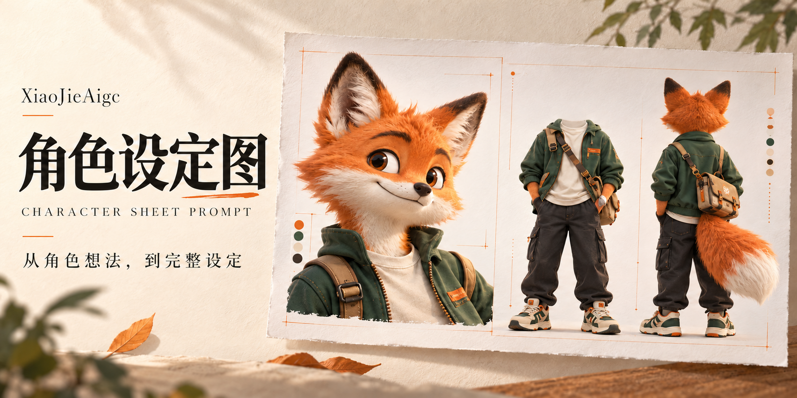

<p align="center">
  
</p>

<h1 align="center">XiaoJieAigc · 角色设定图提示词 Skill</h1>

<p align="center"><strong>把一个角色想法，整理成可以直接拿去生图的完整提示词。</strong></p>
<p align="center">人物 · 动物 · 拟人角色 · 机器人 · 幻想生物</p>
<p align="center"><a href="#快速开始">快速开始</a> · <a href="#安装与导入">安装与导入</a> · <a href="#你会得到什么">输出示例</a> · <a href="./SKILL.md">查看 Skill 正文</a></p>

---

## 这是做什么的？

你不需要先学会写提示词。告诉 AI 想做什么角色，提供已有参考；它会帮你补齐设计、整理素材用途，最后写出一份完整的角色设定图提示词。

> **你提供想法和素材 → Skill 帮你思考与整理 → 输出提示词 → 交给生图模型生成。**

封面为 AI 生成的功能示意图，用于展示角色设定方向，并非使用本 Skill 后的效果保证。

| 你现在有什么 | Skill 会帮你做什么 |
| --- | --- |
| 只有一个角色想法 | 梳理身份、外形、风格与穿搭，提出设计方向 |
| 有脸、发型或服装参考图 | 分清每张图参考哪个部分，组合成统一角色 |
| 已有角色，想换衣服或鞋 | 保留已确定特征，同步修改正面、背面与特写 |
| 想做动物、机器人或其他生物 | 根据物种和身体结构调整设定，不硬套人类模板 |

## 快速开始

安装或导入后，把下面这段话复制给支持 Skill 的 AI 工具：

```text
使用 $xiaojieaigc-character-sheet-prompt。
我想设计一个原创的狐狸快递员，三维动画风格，温暖、有亲和力。
我没有参考图，请先帮我考虑外形、服装、鞋子与配饰。
最终输出2K目标、16:9白底的角色设定图提示词。
使用左40%特写、右60%无头正视图与完整背视图的版式。
```

**有参考图？上传后这样说：**

```text
使用 $xiaojieaigc-character-sheet-prompt。
图1取脸和发型，图2取外套，图3取鞋子，不继承这些图的背景。
裤子和配饰请你帮我搭，整体保持写实城市通勤风。
先判断素材是否够用，再给我完整的角色生图提示词。
```

不支持 `$名称` 的工具，可以选择对应 Skill，或直接说“使用角色设定图提示词技能”。

## 它会怎样和你配合？

**① 先了解角色**　读取你的想法和图片，只补问真正缺少的信息。

**② 帮你做设计**　需要时提出2—3套方向，解释外形、轮廓、配色与穿搭如何配合。

**③ 分清素材用途**　例如“图1只取脸，图2只取上衣”，避免参考图互相干扰。

**④ 输出完整提示词**　把角色、布局、材质、光影与一致性要求写在一起，方便复制。

需要视觉参考时，有图片工具的环境可以检索参考图，或按你的要求生成概念图；没有图片工具时，会提供具体描述和检索方向。没有参考图也可以继续创作。

## 默认版式

| 左侧 · 总宽40% | 右侧 · 总宽60% |
| --- | --- |
| 完整头部及半身特写，展示脸、发型、表情与服饰细节 | 并排展示无头的全身正视图，以及保留后脑的全身背视图 |

**横版16:9 · 2K目标 · 纯白背景 · 同一角色 · 同一套服装**

- 正视图：头颈区域留白，是服装展示方式；不画白面具，也不出现伤口。
- 背视图：保留后脑、发型与背面结构，完整展示衣服、鞋足和配饰。
- 正背身体比例保持一致，脚底对齐，不裁掉鞋子或尾巴等关键结构。

无独立头部或特殊身体结构的角色，会先提出适配方案。画幅与风格也可按你的需求调整。

## 你会得到什么？

最终得到一份中文提示词，通常包含五部分：

```text
【画面排版与核心画质设定】
16:9横版角色设定图，2K目标，纯白影棚背景。左40%为角色特写，
右60%并排展示无头全身正视图与保留后脑的全身背视图。

【左侧区域：40%占比的角色特写】
原创拟人狐狸快递员，橙色短毛、奶白色口鼻、直立大耳朵，
神态温和机灵。穿森林绿工作夹克与奶白色内搭，毛发与织物细节清楚。

【右侧左半部：全身正视图（无头／隐形头颈）】
头颈区域留为纯白背景；展示同款森林绿夹克、深灰工装裤、
橙白运动鞋与斜挎邮差包。自然站立，全身完整入画。

【右侧右半部：全身背视图（保留头部背面）】
保留狐狸后脑与双耳，展示夹克背面、包带和蓬松橙白尾巴。
服装、体型与正视图一致，脚底基线对齐。

【材质、光影与一致性约束】
温暖的三维动画质感，柔和棚光，清晰毛发与布料纹理。
三个区域呈现同一角色；不添加文字、水印、额外肢体或复杂背景。
```

以上是无素材的文字输出示例。实际使用时，Skill 会根据你的角色和参考图重写。

## 安装与导入

**方式一：让支持仓库安装的工具帮你导入。**

```text
请从这个GitHub仓库导入XiaoJieAigc角色设定图提示词Skill：
https://github.com/XiaoJieAi66/XiaoJieAigc-character-sheet-prompt
技能文件是根目录的SKILL.md。
如果当前工具无法安装，请说明手动导入方法，不要声称安装成功。
安装后，先了解我要做什么角色，以及有哪些参考素材。
```

**方式二：手动下载。** 点击仓库上方的 **Code → Download ZIP**，解压后，先把技能文件夹重命名为 `xiaojieaigc-character-sheet-prompt`，再将包含 `SKILL.md` 的 `xiaojieaigc-character-sheet-prompt` 文件夹导入你使用的工具。具体导入入口以该工具说明为准。

普通聊天工具没有 Skill 安装能力时，也可以把 [SKILL.md](./SKILL.md) 全文发给 AI 作为工作说明，再描述任务。

## 常见问题

<details>
<summary><strong>它会直接生成图片吗？</strong></summary>

核心产物是角色生图提示词。把提示词和实际使用的素材交给生图模型，才会得到角色图。生成概念图或最终图需要相应工具能力与明确的生成请求。

</details>

<details>
<summary><strong>一定要准备脸、衣服、鞋子的全部图片吗？</strong></summary>

不用。已有多少就提供多少，没有的部分可以一起设计；完全没有图，也可以从文字开始。

</details>

<details>
<summary><strong>生成角色图后，怎么继续做视频？</strong></summary>

选定角色图后，将它与场景图、剧情想法一起交给配套的视频 Skill。设定图的三个区域代表同一角色；可按工具能力裁切脸部和身体参考，无头展示方式不会沿用到成片角色。

</details>

---

**搭配使用：** [Seedance 2.5 视频提示词 Skill →](https://github.com/XiaoJieAi66/XiaoJieAigc-seedance-2-5-video-prompt)

<p align="center">由 <a href="https://github.com/XiaoJieAi66">XiaoJieAigc</a> 整理 · 让角色想法更容易落地</p>
